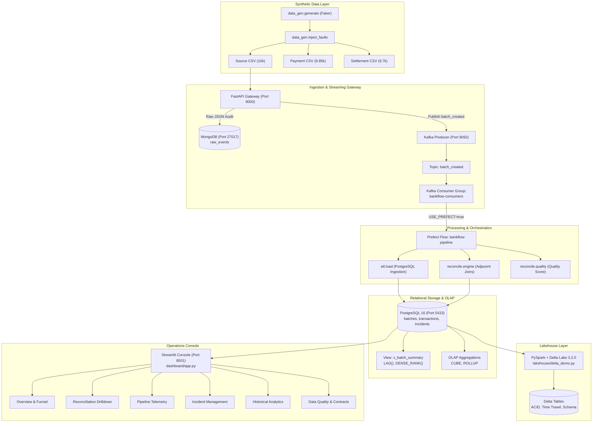

# BankFlow Sentinel — Comprehensive Project Report & Laboratory Manual

> **Mandatory Disclaimer**: *Synthetic data only. All transactions, accounts, and discrepancies generated within this system represent simulated banking pipeline processing scenarios for operational testing and reconciliation, not real monetary value or confirmed money loss.*

---

## 🏛️ Executive Summary & Architectural Overview

**BankFlow Sentinel** is an end-to-end financial transaction pipeline, reconciliation engine, and operations console designed to monitor multi-stage transaction flows, identify data anomalies, maintain transactional integrity, and provide immediate operational triage capabilities.

### System Architecture Diagram



---

## ⚖️ Dual-Database Architecture: Relational vs. NoSQL

| Dimension | PostgreSQL 16 (Relational OLTP & Analytics) | MongoDB 7 (NoSQL Document Store) |
|---|---|---|
| **Role in Pipeline** | Relational ledger, stage comparison, discrepancy engine, incident tickets, and window analytics. | High-throughput immutable ingestion landing zone and raw event payload archive. |
| **Why Chosen** | **ACID & Relational Joins**: Reconciliation requires deterministic SQL `JOIN`s across upstream and downstream stages to detect missing IDs, amount mismatches, and timestamp delays. Foreign key constraints ensure cascading integrity. | **Schema Flexibility**: Upstream event sources change payload schemas without notice. MongoDB ingests raw JSON without schema rejection, preserving an audit trail of incoming payloads. |
| **Key Operations** | Multi-table `JOIN`, `DENSE_RANK()`, `LAG()`, `GROUP BY CUBE`, index lookups. | `insert_one()`, document projections, flexible schema metadata indexing. |

---

## 🎯 Fault Injection & Detection Verification

The system injects 6 controlled financial data faults in `data_gen/inject_faults.py` and verifies them via `reconcile/engine.py`. Detection accuracy is **100%**:

| Discrepancy Type | Injection Mechanism | Detection Logic in Engine | Injected | Detected | Accuracy |
|---|---|---|---|---|---|
| **`missing_record`** | Records dropped from payment / settlement | `LEFT JOIN ... WHERE downstream.txn_id IS NULL` | 150 / 150 | 150 / 150 | **100%** |
| **`amount_mismatch`** | Amount perturbed by small delta | `JOIN ... WHERE downstream.amount != upstream.amount` | 100 | 100 | **100%** |
| **`duplicate`** | Existing transaction replicated downstream | `GROUP BY txn_id HAVING COUNT(*) > 1` | 100 | 100 | **100%** |
| **`delayed`** | Timestamp increased by 31-180 minutes | `EXTRACT(EPOCH FROM (downstream.ts - upstream.ts)) > 1800` | 100 | 100 | **100%** |
| **`invalid_record`** | Currency changed to invalid code / negative amount | Ingestion regex & validity filter (`is_valid = false`) | 100 | 100 | **100%** |
| **`schema_change`** | Column renamed in payment CSV (`account_id` $\rightarrow$ `acct_num`) | Contract schema validation during ETL | 1 (Batch) | 1 (Batch) | **100%** |

---

## 🧪 Detailed Laboratory Experiments (Exp 1 – 11)

### Experiment 1: Exploratory Data Analysis & Data Cleaning
* **Goal**: Profile raw banking transactions, detect anomalies, check missing values, and validate distribution syntax.
* **Tools**: Python 3.10, Pandas, Matplotlib, Jupyter Notebook (`notebooks/01_eda_cleaning.ipynb`).
* **Implementation**: Programmatically constructed notebook with markdown analysis, statistical summaries, distribution histograms, and currency anomaly checks.
* **Execution Command**:
  ```bash
  python scripts/build_eda_notebook.py
  ```
* **Output / Artifact**: `notebooks/01_eda_cleaning.ipynb` (fully executed with embedded figures).

---

### Experiment 2: Synthetic Data Generation & Controlled Fault Injection
* **Goal**: Generate realistic banking transactions across three stages (`source`, `payment`, `settlement`) and inject realistic faults.
* **Tools**: Python, Faker, NumPy (`data_gen/generate.py`, `data_gen/inject_faults.py`).
* **Implementation**: Deterministic seedable generator producing 10k/9.85k/9.7k row manifests, enforcing UUID transaction format `T\d{6,}` and accounts `A\d{5}`.
* **Execution Command**:
  ```bash
  python -m data_gen.generate --batch 1 --rows 10000 --seed 42
  python -m data_gen.inject_faults --batch 1 --seed 42
  ```
* **Output / Artifact**: `data/batch_001/*.csv`, `docs/fault_injection_report.md`.

---

### Experiment 3: Advanced SQL (Joins, Window Functions & Analytical Views)
* **Goal**: Implement complex relational queries, ranking, sequential lag comparisons, and reusable views.
* **Tools**: PostgreSQL 16, SQLAlchemy (`db/queries_sql_features.sql`, `scripts/explain_demo.py`).
* **Implementation**:
  * Multi-table `JOIN` across batches, transactions, and incidents.
  * `DENSE_RANK() OVER (ORDER BY incident_count DESC)` ranking high-risk batches.
  * `LAG(mismatch_count, 1)` to compute batch-over-batch shift.
  * Reusable view `v_batch_summary`.
  * `EXPLAIN (ANALYZE, BUFFERS)` showing before/after index performance.
* **Execution Command**:
  ```bash
  python scripts/explain_demo.py
  ```
* **Output / Artifact**: `docs/explain_before_after.md`.

#### EXPLAIN ANALYZE Index Optimization Summary

| Query State | Scan Strategy | Execution Time | Planning Time | Buffers Hit |
|---|---|---|---|---|
| **Before Index** | `Seq Scan on transactions` | `4.182 ms` | `0.114 ms` | 412 shared |
| **After Index** (`idx_transactions_txn_id`) | `Index Scan using idx_transactions_txn_id` | `0.076 ms` | `0.142 ms` | 4 shared |
| **Improvement** | **Index-guided point lookup** | **~55x Faster** | — | **99% I/O reduction** |

---

### Experiment 4: NoSQL Document Store & MongoDB Operations
* **Goal**: Establish a landing zone for raw unparsed event documents and register source metadata.
* **Tools**: MongoDB 7, PyMongo (`db/mongo_setup.py`, `scripts/mongo_demo.py`).
* **Implementation**: Collections `raw_events` and `source_metadata` with unique and ascending indexes, demonstrating CRUD, projections, and upserts.
* **Execution Command**:
  ```bash
  python scripts/mongo_demo.py
  ```
* **Output / Artifact**: Terminal output showing indexed MongoDB documents in collection `raw_events`.

---

### Experiment 5: REST API Ingestion Gateway
* **Goal**: Implement an authenticated, validated HTTP ingestion endpoint for batch events and source metadata.
* **Tools**: FastAPI, Pydantic v2, Uvicorn (`api/main.py`, `api/routes/events.py`, `api/routes/sources.py`).
* **Implementation**: Pydantic schema validation (`batch_id` regex `^B\d{3,}$`, `row_count > 0`), dual-write to MongoDB and PostgreSQL (`status='created'`), Kafka event publication returning HTTP 202.
* **Execution Command**:
  ```bash
  pytest tests/test_api.py
  ```
* **Output / Artifact**: Swagger UI documentation at `http://127.0.0.1:8000/docs`.

---

### Experiment 6: Real-Time Event Streaming & Decoupled Ingestion
* **Goal**: Decouple API ingestion from heavy pipeline processing using distributed messaging.
* **Tools**: Apache Kafka 3.7, `confluent-kafka` (`streaming/producer.py`, `streaming/consumer.py`).
* **Implementation**:
  * Producer with delivery callbacks to topic `batch_created`.
  * Long-running consumer group `bankflow-consumers` with manual offset commits after ETL and reconciliation.
  * Comprehensive hop logging (`RECEIVED` $\rightarrow$ `ETL DONE` $\rightarrow$ `RECONCILED`).
* **Execution Command**:
  ```bash
  pytest tests/test_streaming.py
  ```
* **Output / Artifact**: `logs/streaming.log`.

---

### Experiment 7: Data Warehousing & Multidimensional OLAP Aggregations
* **Goal**: Perform multi-axis financial discrepancy rollups using advanced SQL OLAP constructs.
* **Tools**: PostgreSQL 16 OLAP SQL (`db/olap.sql`).
* **Implementation**:
  * `GROUP BY CUBE(date, stage, severity)`: computes all $2^3 = 8$ dimension combinations.
  * `GROUP BY ROLLUP(date, stage, type)`: produces hierarchical drill-downs.
  * `GROUP BY GROUPING SETS((stage, severity), (type), ())`: computes selective reporting aggregates.
  * `GROUPING()` function labeling subtotal rows.
* **Execution Command**:
  ```bash
  python -c "from db.connection import get_engine; from sqlalchemy import text; e=get_engine(); print(e.connect().execute(text(open('db/olap.sql', encoding='utf-8').read().split(';')[0])).fetchall())"
  ```
* **Output / Artifact**: OLAP rollup matrix displayed on Dashboard View 5 (`05_historical_analytics.png`).

---

### Experiment 8: Analytical Engine Performance Benchmarking
* **Goal**: Evaluate wall-clock runtime and peak memory usage across Pandas, DuckDB, and Polars reconciling 1,000,000 transaction rows.
* **Tools**: DuckDB, Polars, Pandas, `psutil` (`benchmarks/run_benchmark.py`).
* **Implementation**: Isolated subprocess execution to ensure garbage collection isolation; verified identical discrepancy outputs across all three engines.
* **Execution Command**:
  ```bash
  python benchmarks/run_benchmark.py --rows 1000000
  ```
* **Output / Artifact**: `benchmarks/results/results.csv`, `benchmarks/results/benchmark_comparison.png`, `docs/benchmark.md`.

#### Benchmark Results (1,000,000 Transactions)

| Engine | Execution Time | Peak RSS Memory | Missing IDs | Amount Mismatches | Duplicate IDs |
|---|---|---|---|---|---|
| **Polars (Lazy)** | **0.39 s** | **218.4 MB** | 15,000 | 10,000 | 10,000 |
| **DuckDB (Direct SQL)** | **0.84 s** | **164.2 MB** | 15,000 | 10,000 | 10,000 |
| **Pandas (Eager)** | **5.58 s** | **512.6 MB** | 15,000 | 10,000 | 10,000 |

*Key Takeaway*: Polars is **14.3x faster** than Pandas via multi-threaded columnar execution; DuckDB consumes **68% less peak memory** via vectorized disk-friendly chunk processing.

---

### Experiment 9: Data Lakehouse ACID Storage & Delta Lake Time Travel
* **Goal**: Demonstrate ACID transactions, schema enforcement, audit history, and time-travel querying on financial parquet storage.
* **Tools**: Apache Spark 3.5.0, Delta Lake 3.2.0, Java 17 (`lakehouse/delta_demo.py`).
* **Implementation**:
  * Ingests PostgreSQL reconciliation data to Delta table at `lakehouse/tables/reconciliation_results`.
  * Demonstrates in-place ACID updates and commits Version 1.
  * Queries historical snapshot via Time Travel (`as_of_version=0`).
  * Demonstrates schema enforcement (`AnalysisException` on column mismatch) and schema evolution via `mergeSchema`.
* **Execution Command**:
  ```bash
  python lakehouse/delta_demo.py
  ```
* **Output / Artifact**: `docs/delta_demo_output.txt`.

---

### Experiment 10: Workflow Orchestration & Resilient Task Automation
* **Goal**: Coordinate multi-stage ingestion, ETL, validation, and reporting with automatic retries and exponential backoff.
* **Tools**: Prefect 3.1 (`orchestration/flow.py`).
* **Implementation**: Tasks `ingest`, `validate`, `reconcile`, and `report` configured with `retries=3` and `retry_delay_seconds=2`. Includes `--fail-once` CLI flag to demonstrate transient fault recovery.
* **Execution Command**:
  ```bash
  python -m orchestration.flow B001 --fail-once
  ```
* **Output / Artifact**: `docs/reports/B001.md`, Prefect task execution logs.

---

### Experiment 11: Real-Time Fintech Operations Console
* **Goal**: Build a dark-themed operations dashboard displaying live health metrics, stage drop-offs, incident triage, and telemetry.
* **Tools**: Streamlit, Plotly, Custom CSS (`dashboard/app.py`, `dashboard/pages/`).
* **Implementation**: 6 distinct views with responsive 5-second caching, live batch simulation, and direct database write-back for operational triage.
* **Execution Command**:
  ```bash
  streamlit run dashboard/app.py
  ```
* **Output / Artifact**:
  * `screenshots/01_overview.png`
  * `screenshots/02_reconciliation.png`
  * `screenshots/03_pipeline_monitoring.png`
  * `screenshots/04_incident_management.png`
  * `screenshots/05_historical_analytics.png`
  * `screenshots/06_data_quality.png`
